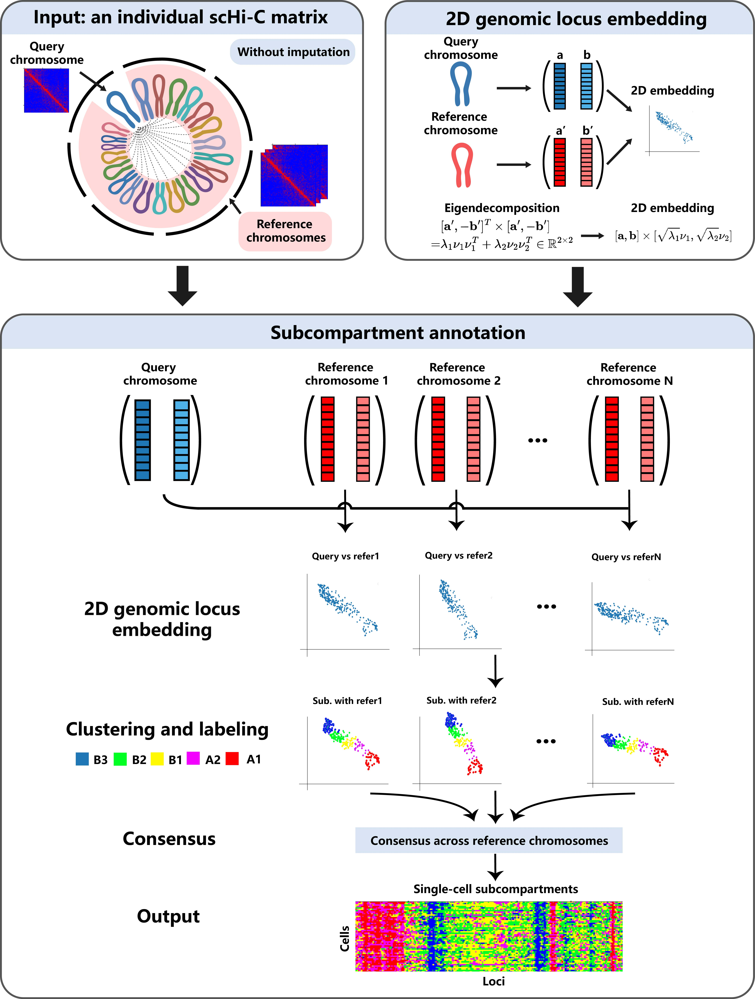

# scSTEC: Direct Subcompartment Annotation from Individual Single-Cell Hi-C Data.

[](https://opensource.org/licenses/MIT)
[](https://www.python.org/)
[](https://www.r-project.org/)

---
## 📌 Abstract & Overview
<p align="center">

</p>
Single-cell Hi-C (scHi-C) technologies enable the exploration of three-dimensional (3D) genome architecture at single-cell resolution. However, annotating chromatin <b>subcompartments</b> (A1, A2, B1, B2, B3) from highly sparse scHi-C matrices remains a significant computational challenge. Existing bulk Hi-C methods rely on inter-chromosomal contact matrices that are unavailable for single cells, while existing state-of-the-art computational frameworks (e.g., scGHOST) employ deep neural network imputation, multi-step upstream pipelines, and cross-cell information sharing to address this task. These strategies risk attenuating cellular heterogeneity, compromising algorithmic interpretability, and demanding heavy computational resources. 

&emsp;<b>scSTEC</b>(<b>s</b>ingle-<b>c</b>ell <b>S</b>ubcompartment
annotation via <b>T</b>wo-dimensional <b>E</b>mbedding and chromosomewise <b>C</b>onsensus) is an efficient, interpretable computational framework for annotating chromatin subcompartments directly from individual scHi-C / scMicro-C matrices without requiring matrix imputation or inter-chromosomal contacts.

### Key Innovations of scSTEC:
1. **2D Genomic Representation**: For each genomic locus, scSTEC quantifies its interactions with top CpG-dense (A) and CpG-poor (B) genomic neighbors ($a_i, b_i$).
2. **Eigenvector-Guided 2D Embedding**: Leverages rank-2 properties of estimated inter-chromosomal matrices in scGHOST to do clustering in 2D space.
3. **Chromosome-Wise Consensus**: Votes on subcompartment classifications across all reference chromosomes ($N_c - 1$ classifiers), providing robust subcompartment annotations ($A1, A2, B1, B2, B3$) alongside uncertainty quantifications.

---

## 🏗️ Repository Architecture

```
scSTEC/
├── README.md                 # Main documentation and tutorial guide
├── requirements.txt          # Python package dependencies
├── calc_cpg_density.R        # Step 1: Compute genome-wide CpG density
├── filter_bad_bins.py        # Step 2: Filter out low-coverage bins
├── scstec_main.py            # Step 3: Main function, 2D embedding & subcompartment annotation
├── extract_pairs_contacts.py # Optional: Process the input pairs.gz file, extract pairs for each chromosome
├── data/                     # Directory for all input files
├── reference/                # Directory for reference files
└── scstec_results/           # Directory for output files
```

---

## ⚙️ Requirements & Installation

### Prerequisites
* **Python**: `>= 3.8`
* **R**: `>= 4.0`

### 1. Python Environment Setup
The main pipeline is implemented in Python.

Create a conda environment and install the required dependencies:
```bash
conda create -n scstec python=3.9 -y
conda activate scstec

# Install Python requirements
pip install -r requirements.txt
```

### 2. R Environment Dependencies
R is only used to compute genome-wide CpG density across a range of resolutions.

Install required Bioconductor packages for R:
```R
if (!requireNamespace("BiocManager", quietly = TRUE))
    install.packages("BiocManager")

BiocManager::install(c("Biostrings", "GenomicRanges"))
```

---

## 🚀 Quick Start Tutorial

The scSTEC workflow consists of three standardized steps:

### Step 1: Calculate Genome CpG Density
Generate genome-wide CpG densities from a reference FASTA file (e.g., `hg38.fa` or `mm10.fa`):

```bash
Rscript calc_cpg_density.R \
  --fasta ./reference/hg38.fa \
  --window_size 500000 \
  --step_size 500000 \
  --species human \
  --output ./reference/hg38_500k_CpG.txt
```

---

### Step 2: Filter Out Low-Coverage Bad Bins
Identify genomic bins with insufficient total read counts across single cells:

For human (here the input is in `.hic` format)
```bash
python3 filter_bad_bins.py \
  --chrom_sizes ./reference/hg38.chrom.sizes \
  --sample_list ./data/human/sample_list.txt \
  --hic_dir ./data \
  --resolution 500000 \
  --min_reads 10 \
  --num_chroms 22 \
  --output ./data/bad_bins_blacklist_500k.txt
  --hic_format hic
```
For mouse (here the input is in `.pairs` format, need to run `extract_pairs_contacts.py` first)
```bash
python3 filter_bad_bins.py \
  --chrom_sizes ./reference/mm10.chrom.sizes \
  --sample_list ./data/mouse/mouse_sample_list.txt \
  --hic_dir ./processed_pairs \
  --resolution 500000 \
  --min_reads 10  \
  --num_chroms 19 \
  --output ./data/mouse/bad_bins_blacklist_500k.txt
  --hic_format pairs
```
---

### Step 3: Subcompartment Annotation
Annotate chromatin subcompartments for all single cells:

For human (here the input is in `.hic` format)
```bash
python3 scstec_main.py \
  --sample_list ./data/sample_list.txt \
  --hic_dir ./data/ \
  --cpg_file ./reference/hg38_500k_CpG.txt \
  --blacklist_file ./data/bad_bins_blacklist_500k.txt \
  --chrom_sizes ./reference/hg38.chrom.sizes \
  --resolution 500000 \
  --num_chroms 22 \
  --n_jobs 10 \
  --out_dir ./scstec_results/human
  --hic_format hic
```
For mouse (here the input is in `.pairs` format)
```bash
python3 scstec_main.py   \
  --sample_list ./data/mouse/mouse_sample_list.txt   \
  --hic_dir ./processed_pairs   \
  --cpg_file ./reference/mm10_500k_CpG.txt   \
  --blacklist_file ./data/mouse/bad_bins_blacklist_500k.txt   \
  --chrom_sizes ./reference/mm10.chrom.sizes   \
  --resolution 500000   \
  --num_chroms 19   \
  --n_jobs 10   \
  --out_dir ./scstec_results/mouse
  --hic_format pairs
```
---

## 📊 Output Format & Subcompartment Encoding

The output consists of four compressed NumPy binary arrays (`.npy`):

1. **`scSTEC_subcompartments_<reso>.npy`**:
   * Shape: `(N_cells, Total_Genomic_Loci)`
   * Encoded Integer Values:
     * `4`: **A1** (Highest CpG density / Active euchromatin)
     * `3`: **A2** (Active euchromatin)
     * `2`: **B1** (Facultative heterochromatin / H3K27me3 enriched)
     * `1`: **B2** (Inactive heterochromatin)
     * `0`: **B3** (Inactive heterochromatin / Lowest CpG density)
2. **`scSTEC_confidence_<reso>.npy`**:
   * Shape: `(N_cells, Total_Genomic_Loci)`
   * Values range from `0.0` to `1.0`, indicating the ratio of reference chromosomes that agreed on the assigned subcompartment
3. **`scSTEC_res_all_<reso>.npy`**:
   * Shape: `(N_cells, Total_Genomic_Loci, Num_of_Ref_Chrom)`
   * All subcompartment annotations from each reference chromosome
4. **`filtered_cells_100k.npy`**:
   * Indices of cells filtered out due to insufficient data quality

---

## 🔧 Script Arguments & Detailed Parameters

This section provides comprehensive parameter explanations for all scripts in scSTEC.

### Step 1. `calc_cpg_density.R`
Calculates genome-wide CpG densities from a reference FASTA genome file.

**Usage:**
```bash
Rscript calc_cpg_density.R --fasta <genome.fa> [options]
```

**Parameters:**
| <div style="width: 120px;">Parameter</div>  | Type | Default | Description |
| :--- | :--- | :--- | :--- |
| `--fasta` | string | *Required* | Path to the input reference genome FASTA file (e.g. `hg38.fa`, `mm10.fa`). |
| `--output` | string | `hg38_100k_CpG.txt` | Output text file path for the calculated CpG density table. |
| `--window_size` | integer | `100000` | Sliding window size in base pairs (bp). |
| `--step_size` | integer | `100000` | Sliding step size in base pairs (bp). |
| `--species` | string | `human` | Species assembly to process: `'human'` (autosomes chr1–22) or `'mouse'` (autosomes chr1–19). |

---

### Step 2. `filter_bad_bins.py`
Scans single-cell `.hic` contact maps to identify and blacklist low-coverage / unmappable genomic bins with insufficient cumulative read counts.

**Usage:**
```bash
python3 filter_bad_bins.py \
  --chrom_sizes <file> \
  --sample_list <file> \
  --hic_dir <dir> \
  [options]
```

**Parameters:**
| <div style="width: 120px;">Parameter</div> | Type | Default | Description |
| :--- | :--- | :--- | :--- |
| `--chrom_sizes` | string | *Required* | Path to chromosome sizes file (two-column tab-delimited: chrom and length, e.g. `hg38.chrom.sizes`). |
| `--sample_list` | string | *Required* | Path to text file containing sample IDs (one cell ID per line, matching `<cell_id>.hic`). |
| `--hic_dir` | string | *Required* | Directory containing single-cell contact maps in `.hic` format. |
| `--resolution` | integer | `500000` | Genomic bin resolution in base pairs (bp). |
| `--min_reads` | integer | `10` | Minimum cumulative read count threshold across all cells; bins with fewer reads are blacklisted. |
| `--num_chroms` | integer | `22` | Number of autosomes to evaluate (`22` for human, `19` for mouse). |
| `--output` | string | `bad_bins_blacklist_500k.txt` | Output path for the low-coverage bad bins blacklist text file. |
| `--hic_format` | string | `pairs` | The input data format, either `hic` or `pairs`, other format not supported yet. |
---

### Step 3. `scstec_main.py`
Executes 2D genomic embedding, reference chromosome voting, and consensus clustering to annotate chromatin subcompartments across individual cells.

**Usage:**
```bash
python3 scstec_main.py \
  --sample_list <file> \
  --hic_dir <dir> \
  --cpg_file <file> \
  --blacklist_file <file> \
  --chrom_sizes <file> \
  [options]
```

**Parameters:**
| <div style="width: 180px;">Parameter</div> | Type | Default | Description |
| :--- | :--- | :--- | :--- |
| `--sample_list` | string | *Required* | Path to sample list text file (one cell ID per line). |
| `--hic_dir` | string | *Required* | Directory containing single-cell `.hic` contact files. |
| `--cpg_file` | string | *Required* | Path to CpG density reference table generated by `calc_cpg_density.R`. |
| `--blacklist_file` | string | *Required* | Path to low-coverage bad bin blacklist generated by `filter_bad_bins.py`. |
| `--chrom_sizes` | string | *Required* | Path to chromosome sizes file (e.g. `hg38.chrom.sizes` or `mm10.chrom.sizes`). |
| `--resolution` | integer | `500000` | Genomic bin resolution in base pairs (bp). |
| `--num_chroms` | integer | `22` | Number of autosomes to annotate (`22` for human, `19` for mouse). |
| `--n_jobs` | integer | `0` | Number of parallel worker CPU processes (`0` uses all available cores minus 1). |
| `--filter_out_bin_ratio` | integer | `20` | Quality filtering threshold (%): maximum allowed percentage of zero-representation loci before cell exclusion. |
| `--ab_thre` | integer | `30` | Percentile threshold for defining top CpG-dense (A) and CpG-poor (B) anchor bins. |
| `--out_dir` | string | `scstec_results` | Output directory where `.npy` prediction and confidence arrays will be stored. |
| `--hic_format` | string | `pairs` | The input data format, either `hic` or `pairs`, other format not supported yet. |
---

### (Optional) `extract_pairs_contacts.py`
Processes raw single-cell `.pairs` or `.pairs.gz` files from a sample list to generate chromosome-wise sparse contact matrices at a specified resolution.

**Usage:**
```bash
python3 extract_pairs_contacts.py \
  --chrom_sizes <file> \
  --sample_list <file> \
  --pairs_dir <dir> \
  [options]
```

**Parameters:**
| <div style="width: 120px;">Parameter</div> | Type | Default | Description |
| :--- | :--- | :--- | :--- |
| `--chrom_sizes` | string | *Required* | Path to chromosome sizes file (e.g. `mm10.chrom.sizes` or `hg38.chrom.sizes`). |
| `--sample_list` | string | *Required* | Path to sample list text file (one cell ID per line, matching `<cell_id>.pairs.gz` or `<cell_id>.pairs`). |
| `--pairs_dir` | string | *Required* | Directory containing single-cell `.pairs` / `.pairs.gz` contact files. |
| `--resolution` | integer | `500000` | Genomic bin resolution in base pairs (bp). |
| `--num_chroms` | integer | `19` | Number of autosomes (`19` for mouse, `22` for human). |
| `--out_dir` | string | `./processed_pairs` | Output directory for saving per-chromosome contact text files (`<cell_id>_chr<chrom>_<res>k.txt`). |

---

## 📖 Citation

If you use **scSTEC** in your research, please cite:

> Yongli Peng\*, Liyuan Yang\*, and Hao Ge.  
> **scSTEC: Annotating Chromatin Subcompartments from Individual Single-Cell Hi-C Data via Direct Two-Dimensional Embedding and Chromosome-wise Consensus.**  
> *Bioinformatics*, 2026. DOI: [10.1093/bioinformatics/xxxxx](https://doi.org/10.1093/bioinformatics/xxxxx)

---

## 📄 License

This project is licensed under the MIT License - see the [LICENSE](LICENSE) file for details.
